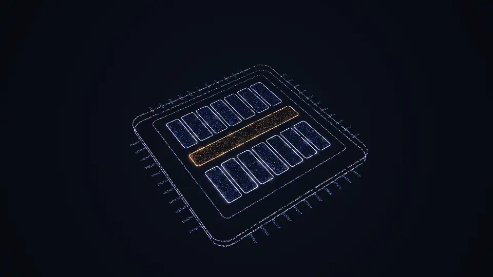
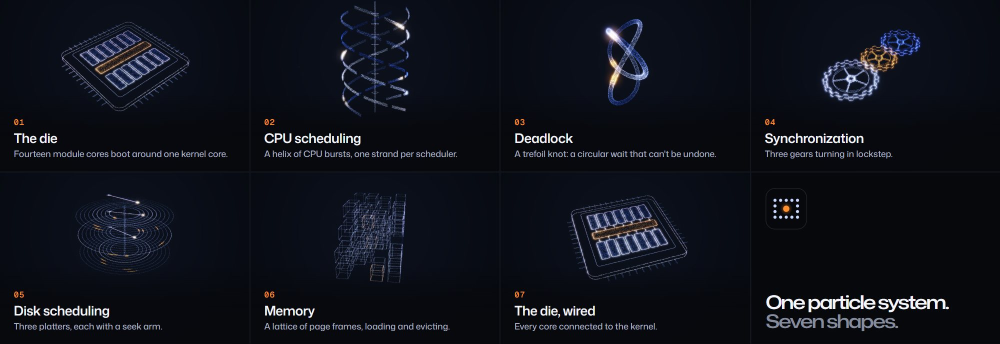
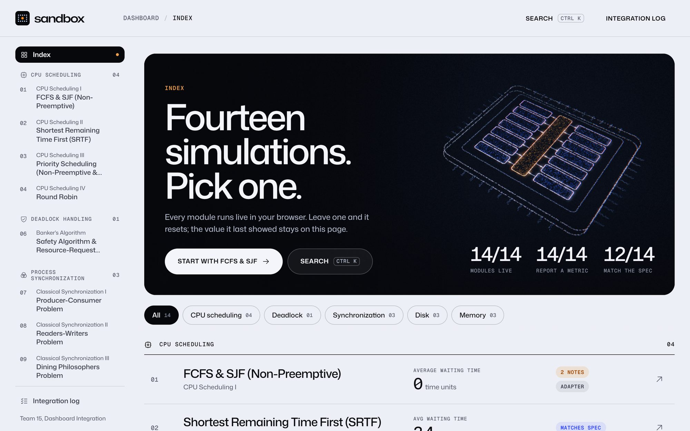
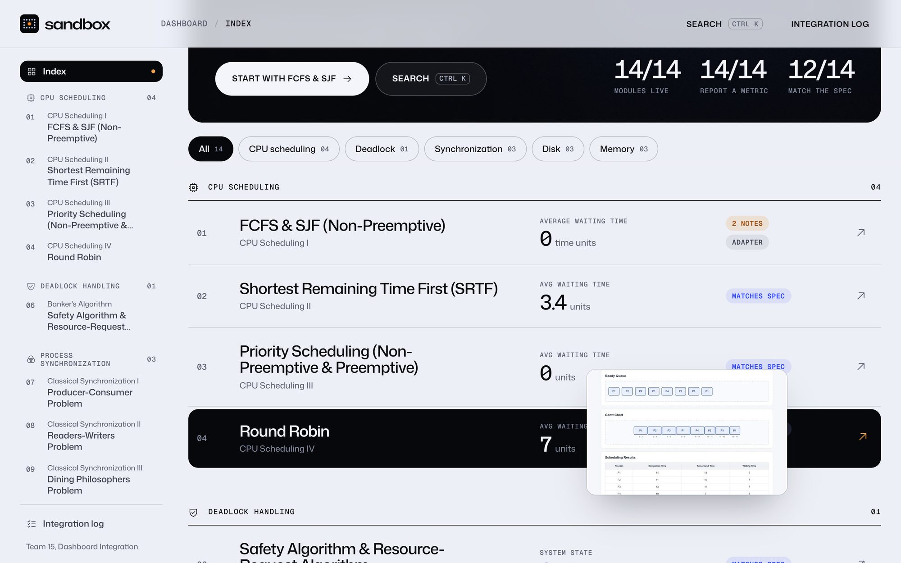
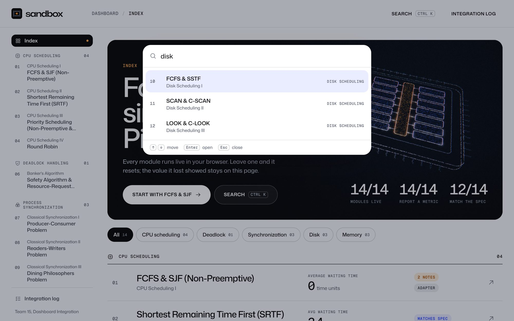
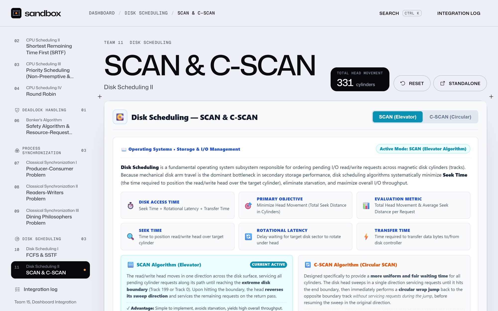
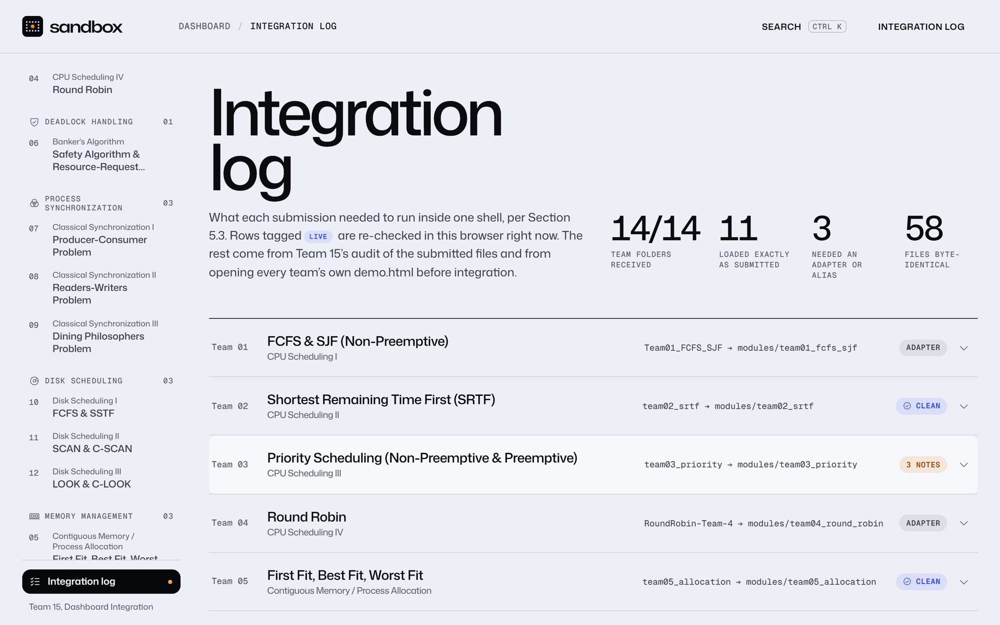
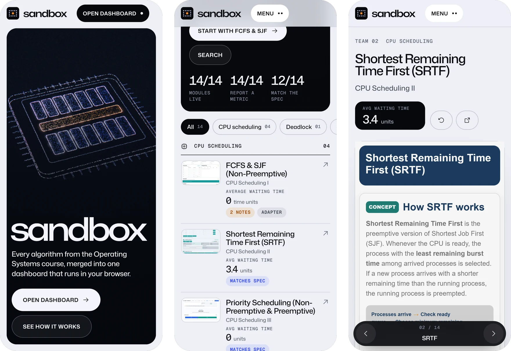
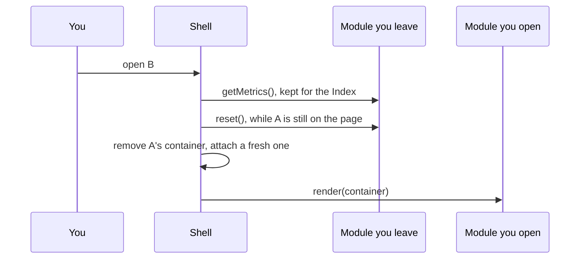

<div align="center">

<a href="https://sandbox-os.vercel.app">
  <picture>
    <source media="(prefers-color-scheme: dark)" srcset=".github/media/lockup-dark.png">
    
  </picture>
</a>

<h3>Operating systems, simulated.</h3>

Fourteen OS algorithms, built by fourteen different teams,<br>
running as one live dashboard in your browser.

<br>

[**sandbox-os.vercel.app**](https://sandbox-os.vercel.app) &nbsp;·&nbsp; [Open the dashboard](https://sandbox-os.vercel.app/#/overview) &nbsp;·&nbsp; [Integration log](https://sandbox-os.vercel.app/#/integration) &nbsp;·&nbsp; [How it works](#how-it-works)

<br>


</div>

<br>

<p align="center">
  <a href="https://sandbox-os.vercel.app"></a>
</p>

<br>

An Operating Systems course split the class into fifteen teams. Teams 1 to 14 each built one algorithm as a self-contained simulator, under one shared contract: vanilla JavaScript, Chart.js as the only library, and a `render`, `reset` and `getMetrics` interface on a global registry. Team 15's job was to turn fourteen separately built modules into one product.

**sandbox is that product.** Fourteen teams read the contract fourteen ways. One restyled `html` and `body` for the whole page. One shipped 260 unscoped selectors. One never registered with the dashboard at all, and another kept its entire module inside its demo page. sandbox runs all fourteen side by side anyway, without changing a single byte of anyone's code.

<br>

<div align="center">
<table>
  <tr>
    <td align="center" width="25%"><h2>14 / 14</h2>modules live</td>
    <td align="center" width="25%"><h2>58</h2>team files, byte for byte<br>as submitted</td>
    <td align="center" width="25%"><h2>0</h2>console errors across<br>the end-to-end runs</td>
    <td align="center" width="25%"><h2>0</h2>build steps, installs<br>or servers needed</td>
  </tr>
</table>
</div>

<br>

## Seven shapes, one particle system

<p></p>

The landing page is one scroll-driven story, one chapter per topic in the course. A WebGL2 engine, written by hand for this project, draws every particle in a single draw call. As you scroll, the particles leave one shape and sweep into the next, and the object turns with you.

- **Built from nothing but an index.** No particle positions are ever uploaded. Each shape is a function in the vertex shader that turns `gl_VertexID` into a position, a colour and a size. Every shape lays its particles out in the same order, so neighbours travel together and a morph reads as one motion, not a cloud.
- **It reacts to you.** Particles under the pointer part and brighten. Drag to turn the object; it keeps your momentum. Click to send a ripple through it. Hover a module link and that module's part of the object lifts.
- **Nothing compiles while you scroll.** Each morph between two neighbouring shapes is its own shader program, compiled behind the loader with `KHR_parallel_shader_compile`. The loader counts that real work: fonts, programs, first frames. The fourteen dots of the logo light up as it goes.
- **Post-processing** adds half-resolution bloom, a faint chromatic aberration, a vignette and film grain.

<br>

## The dashboard

<p></p>

**The Index** reads every module's `getMetrics()` live and shows its label, value and unit exactly as the module reports them. Rows are flagged where the label or unit differs from the spec. When you leave a module it resets, but the value it last showed stays on the Index. Filter by topic with the pills.

<table>
  <tr>
    <td width="50%"></td>
    <td width="50%"></td>
  </tr>
  <tr>
    <td><b>Hover a row</b> to preview the module beside your cursor, and its core lights up on the die at the top.</td>
    <td><b>Press <kbd>Ctrl</kbd> <kbd>K</kbd></b> (<kbd>⌘</kbd> <kbd>K</kbd> on a Mac) to jump anywhere. Switches made from the keyboard are instant.</td>
  </tr>
</table>

<p></p>

**Every module gets its own stage.** The header carries its live metric, **Reset**, which calls `reset()` and renders it fresh, and **Standalone**, which opens the team's own demo page. Step through the modules with <kbd>[</kbd> and <kbd>]</kbd>.

<p></p>

**The integration log** shows what every submission needed to run inside one shell. Some of its checks re-run live in your browser. It also lists every adapter, the SHA-256 of every submitted file, and screenshots of each team's demo tested on its own before integration. The full write-up is in [INTEGRATION_LOG.md](INTEGRATION_LOG.md).

<br>

## On your phone

<p align="center"></p>

The landing scene scales down to the device. The Index shows a thumbnail for every module instead of hover previews. Module pages get a bottom bar: previous, `02 / 14` (tap it to pick any module), next.

<br>

## The fourteen modules

Every name links straight into that module on the live site.

| Topic | Team | Module | Live metric |
|---|:-:|---|---|
| **CPU scheduling** | 01 | [FCFS & SJF (Non-Preemptive)](https://sandbox-os.vercel.app/#/m/team01_fcfs_sjf) | Average waiting time |
| | 02 | [Shortest Remaining Time First](https://sandbox-os.vercel.app/#/m/team02_srtf) | Average waiting time |
| | 03 | [Priority Scheduling](https://sandbox-os.vercel.app/#/m/team03_priority) | Average waiting time |
| | 04 | [Round Robin](https://sandbox-os.vercel.app/#/m/team04_round_robin) | Average waiting time |
| **Deadlock** | 06 | [Banker's Algorithm](https://sandbox-os.vercel.app/#/m/team06_bankers) | System state |
| **Synchronization** | 07 | [Producer-Consumer](https://sandbox-os.vercel.app/#/m/team07_prod_cons) | Buffer utilization |
| | 08 | [Readers-Writers](https://sandbox-os.vercel.app/#/m/team08_readers_writers) | Active readers |
| | 09 | [Dining Philosophers](https://sandbox-os.vercel.app/#/m/team09_dining_phil) | Meals served |
| **Disk scheduling** | 10 | [FCFS & SSTF](https://sandbox-os.vercel.app/#/m/team10_disk_fcfs_sstf) | Total head movement |
| | 11 | [SCAN & C-SCAN](https://sandbox-os.vercel.app/#/m/team11_disk_scan) | Total head movement |
| | 12 | [LOOK & C-LOOK](https://sandbox-os.vercel.app/#/m/team12_disk_look) | Total head movement |
| **Memory** | 05 | [First, Best & Worst Fit](https://sandbox-os.vercel.app/#/m/team05_allocation) | Internal fragmentation |
| | 13 | [FIFO & LRU page replacement](https://sandbox-os.vercel.app/#/m/team13_page_fifo_lru) | Page faults |
| | 14 | [Optimal page replacement](https://sandbox-os.vercel.app/#/m/team14_page_optimal) | Page faults |

<br>

## How it works

### Fourteen stylesheets, zero collisions

Several submissions style the whole page: `html`, `body`, `*`, `:root` variables, hundreds of unprefixed classes. Loaded side by side, they would restyle the dashboard and each other.

So every team stylesheet goes into its own **CSS cascade layer**, and is switched on only while that module is on screen:

```html
<style>@layer team01, team02, team03, … team14;</style>

<!-- one per module, fetched the first time it opens -->
<style media="not all">@import url("modules/team03_priority/style.css") layer(team03);</style>
```

The dashboard's own styles are not in any layer, and unlayered styles always beat layered ones, whatever their specificity. A module can do what it likes inside its layer, and the shell still wins. The shared `theme.css` loads unlayered too, so no module can redefine the theme colours for anyone else.

### The switch, in five steps

Every module switch runs the same sequence, so a module never renders twice into the same container and never resets after it has been removed:



- A generation counter cancels a switch that a newer one has overtaken, so fast keyboard switching never mounts two modules.
- Every call into a module is wrapped in `try/catch`. If a module fails, its stage shows an inline message with a link to the team's own demo, and the failure is logged for the integration report rather than thrown at you.
- Chart.js loads only when a module that draws charts opens. The bundled copy is used first, with a CDN fallback.

### Adapters, never edits

Three submissions could not load as they were. Each one gets Team 15 code next to it, and none of it touches a team file:

| Team | Problem | What sandbox does |
|:-:|---|---|
| 01 | `module.js` is one comment; the real module is an inline script in `demo.html` | `tools/extract-compat.mjs` copies that script out byte for byte |
| 04 | Never registers, and has no `render`, `reset` or `getMetrics` | An adapter provides the interface around Team 4's own markup and functions |
| 10 | Registers under the wrong key | One alias adds the correct key |

`node tools/verify.mjs` proves it. It checks every one of the 58 files in `modules/` against the SHA-256 recorded when it was received, and that the Team 1 and Team 4 extractions still equal the bytes they were cut from.

### Fast on purpose

- **Quality adapts to the device.** The engine starts on a tier of 26,000, 18,000 or 9,000 particles, and caps the drawing buffer at about 2.1 million pixels so large screens don't pay for pixels nobody sees. A frame-time probe steps down a tier when frames run slow, or when they only stutter, and stops probing once it has seen three smooth windows in a row.
- **The scene stops drawing** when it scrolls out of view or you leave the landing, and browsers pause it in background tabs.
- **Fallbacks:** without WebGL2, on a software renderer, or with reduced motion requested, the landing cross-fades still frames rendered from the same scene and turns off smooth scrolling. Add [`?nogl`](https://sandbox-os.vercel.app/?nogl) to the URL to see that mode.
- **Motion** is Lenis smooth scrolling with GSAP ScrollTrigger, and every scroll animation is scrubbed: scroll back and it plays backwards. Nothing pins and nothing snaps.

<div align="center">

| Lighthouse, landing page | Performance | Accessibility | Best practices | SEO |
|---|:-:|:-:|:-:|:-:|
| Desktop | **100** | 95 | **100** | **100** |
| Mobile | 91 | 95 | **100** | **100** |

</div>

<br>

## Run it

> [!TIP]
> **Double-click `index.html`.** That's the whole setup.

No server, no `npm install`, no build step. Every library is in `vendor/`, and the fonts are embedded as data URIs because browsers block font files on `file://`, so it works offline too. To serve it instead, any static server will do:

```bash
python -m http.server 8000      # then open http://localhost:8000
```

Deep links work from the first load: `#/overview`, `#/m/team04_round_robin`, `#/integration`.

| Keys | What they do |
|---|---|
| <kbd>Ctrl</kbd> <kbd>K</kbd> / <kbd>⌘</kbd> <kbd>K</kbd> | Quick switcher |
| <kbd>[</kbd> &nbsp; <kbd>]</kbd> | Previous / next module |
| <kbd>Esc</kbd> | Close the switcher or the menu |

**Browsers:** Chrome or Edge 108+, Firefox 110+, Safari 16+ (it needs CSS cascade layers and WebGL2).

**Check the team files:** you need Node 18 or newer.

```bash
node tools/verify.mjs           # exit code 0: all 58 team files match their submissions
```

<details>
<summary><b>What's in this repository</b></summary>

<br>

```
index.html            the shell and the landing page; its first script creates the shared registry
theme.css             the five shared colour variables every module uses
modules/              the 14 team folders, byte-identical to what each team submitted
shell/
  registry.js         one entry per module: key, title, files, expected metric
  lifecycle.js        loading, cascade layers, the reset/render cycle, metric checks
  app.js              navigation, Index, integration log, quick switcher, routing
  sandbox.css         every dashboard style (unlayered, so it always wins)
  compat/             the Team 1, 4 and 10 adapters
landing/
  landing.js          the scroll story, loader, pointer and drag interaction
  gl/engine.js        the WebGL2 particle engine
  posters/            still frames for the no-WebGL fallback
integration/          audit data, the SHA-256 manifest, isolation screenshots
assets/               embedded fonts, the logo and social card, licences
vendor/               Chart.js, GSAP with ScrollTrigger and SplitText, Lenis
tools/                maintainer scripts (Node 18+), not needed to run anything
INTEGRATION_LOG.md    the integration log in full
```

</details>

<br>

## Credits

- **The fourteen modules** in `modules/` were built by Teams 1 to 14 of the course, and each one belongs to the team that built it. Team folders were renamed to one `teamNN_name` pattern when they were copied in; their contents were not changed. [INTEGRATION_LOG.md](INTEGRATION_LOG.md) maps every original name.
- **Chart.js** 4.4.2, MIT licence.
- **GSAP** 3.13 with ScrollTrigger and SplitText, © GreenSock, under the [GSAP Standard "no charge" licence](https://gsap.com/standard-license).
- **Lenis** 1.3.4 by darkroom.engineering, MIT licence.
- **Sandbox Sans** is a Latin subset of Mona Sans, and **Sandbox Mono** a Latin subset of Geist Mono, both under the SIL Open Font License 1.1. Mona Sans was renamed because "Mona" is a Reserved Font Name.
- **Icons** from Phosphor Icons, MIT licence.

The other licence texts are in `vendor/` and `assets/`.

<br>

## How it was made

sandbox is Team 15's integration component, designed and built by **Dhruv Sonar** in September and October 2026. Every submission was audited and tested on its own before it was merged, and the evidence is in `integration/`.

The course allows generative AI if it is cited: Claude Code (Anthropic) was used as an AI pair programmer for the audit, the shell, the adapters, the landing page and its WebGL scene, the tools and the browser tests. Every result was reviewed and tested, and `tools/verify.mjs` confirms no team module was edited.

<br>

## Licence

© 2026 Dhruv Sonar. All rights reserved.

The dashboard shell, the landing page, the particle engine, the logo and the documentation are not open source. You may not copy, modify or redistribute them without written permission. The modules in `modules/` belong to their teams, and the third-party libraries keep their own licences.

<br>

<div align="center">
  
  <br>
  <sub>Operating systems, simulated.</sub>
</div>
