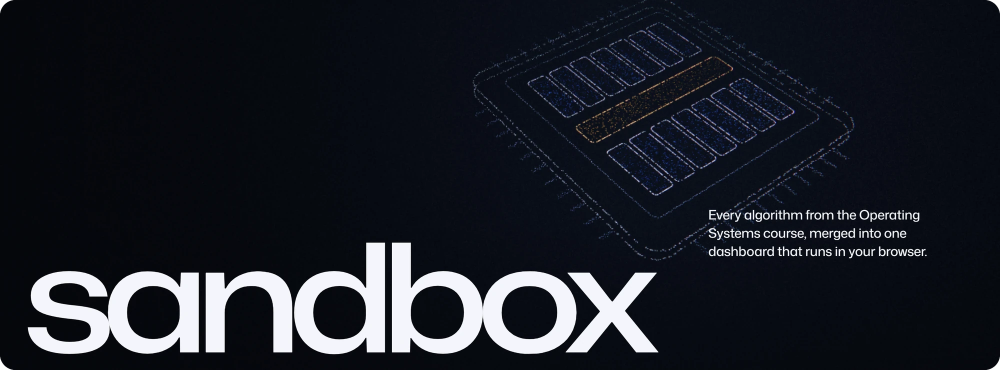
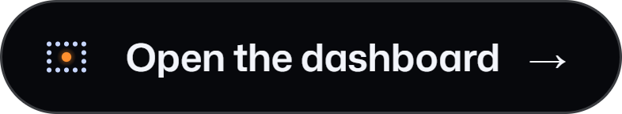
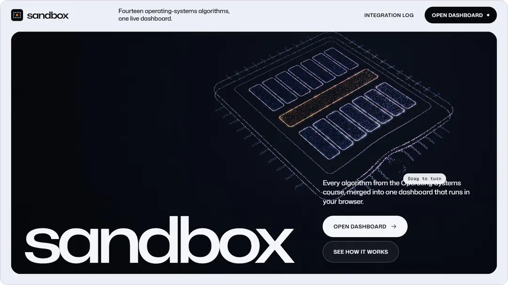
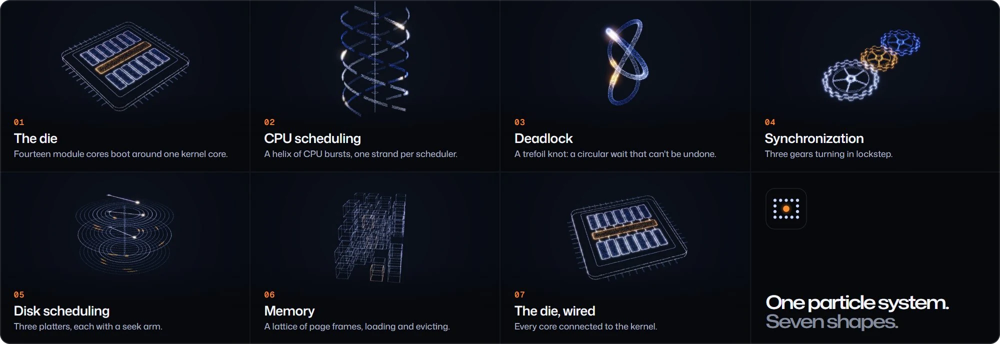
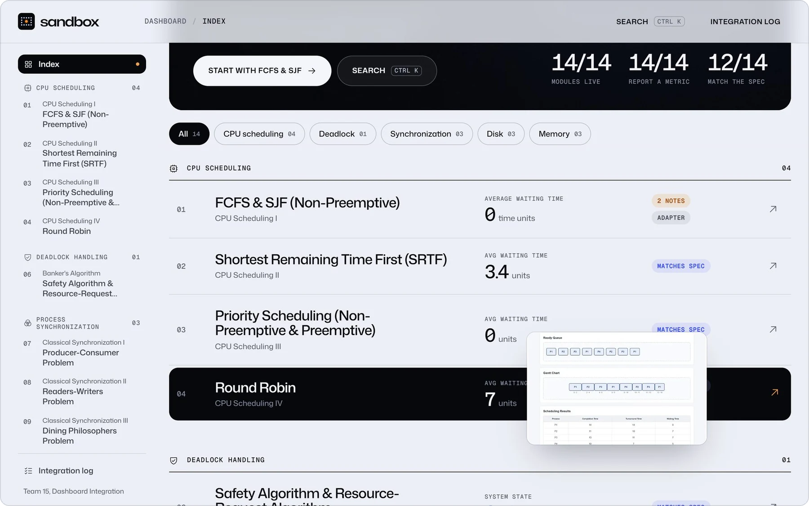
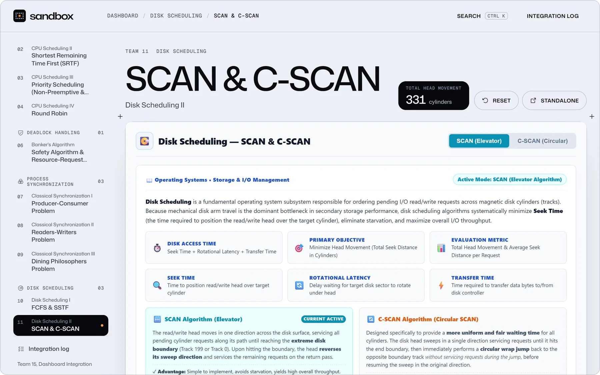

 

  <b>sandbox</b> turns an operating systems course into something you can touch. 
  Fourteen algorithms, built by fourteen student teams, running side by side in one live dashboard.

  

  14 modules&ensp;·&ensp;5 topics&ensp;·&ensp;one particle system, written by hand

 

 
 

### One object, seven shapes.

The landing page is a single scroll-driven story. One hand-built particle object takes a new shape for every topic, from CPU scheduling to memory, and turns with the reader as they scroll.

 
 

### Every module, live.

The index reads each simulation's own metric while it runs. Hovering a row previews the module beside the cursor and lights up its core on the die. <kbd>Ctrl</kbd> <kbd>K</kbd> jumps anywhere.

 
 

### Fourteen teams, one stage.

Every team's simulation runs untouched inside a shared shell, with its own stage, its own controls and its live metric in the header.

 
 

### In the pocket, too.

 
 

### The fourteen

<table>
  <tr><td><b>CPU scheduling</b></td><td>FCFS &amp; SJF&ensp;·&ensp;Shortest Remaining Time First&ensp;·&ensp;Priority&ensp;·&ensp;Round Robin</td></tr>
  <tr><td><b>Deadlock</b></td><td>Banker's algorithm</td></tr>
  <tr><td><b>Synchronization</b></td><td>Producer–Consumer&ensp;·&ensp;Readers–Writers&ensp;·&ensp;Dining Philosophers</td></tr>
  <tr><td><b>Disk scheduling</b></td><td>FCFS &amp; SSTF&ensp;·&ensp;SCAN &amp; C-SCAN&ensp;·&ensp;LOOK &amp; C-LOOK</td></tr>
  <tr><td><b>Memory</b></td><td>First, Best &amp; Worst Fit&ensp;·&ensp;FIFO &amp; LRU paging&ensp;·&ensp;Optimal paging</td></tr>
</table>

 

  
    
  The modules were built by Teams 1 to 14 of the Operating Systems course, and each belongs to the team that built it. 
  The dashboard, the landing page and its particle engine are Team 15's, designed and built by Dhruv Sonar.
    
  WebGL2, GSAP and Lenis. Type in Mona Sans and Geist Mono. The course allows generative AI when it is cited: 
  Claude Code was used as an AI pair programmer, and every result was reviewed and tested.
    
  © 2026 Dhruv Sonar. All rights reserved. The team modules and third-party libraries keep their own terms.

